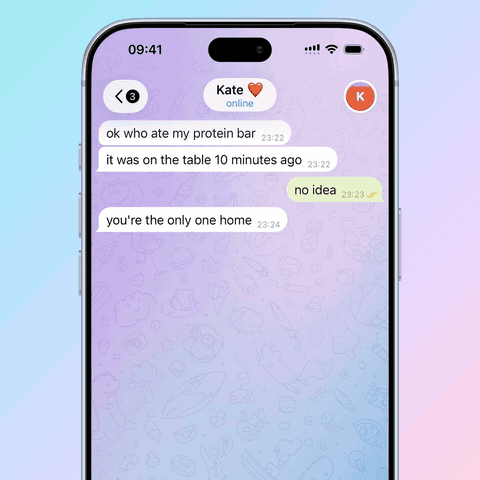

# Quick Stickers

A concept for Telegram on iOS: **send a sticker in a single gesture.** Press
and hold the sticker button, slide onto a sticker, let go, and it's sent.

  

  <a href="docs/media/quick-stickers-demo.mp4"><b>▶ Watch the demo video</b></a>
  &nbsp;·&nbsp;
  <a href="https://t.me/artem_designich">Telegram channel: @artem_designich</a>

## The problem

A sticker is usually a quick reaction, but sending one takes more steps than
typing "ok":

1. Tap the sticker button.
2. Wait for the keyboard to change into the sticker panel, which covers half
   the chat.
3. Find the sticker you want.
4. Tap it.
5. Close the panel to get back to the conversation.

Most of the time it's a sticker you sent recently. The panel opens anyway, the
chat moves up and you lose your place in the conversation.

## The idea

Reacting to a message already works with one gesture: hold, slide, release.
Quick Stickers brings the same gesture to sending stickers.

- **Hold** the sticker button in the composer. Your recent stickers fan out of
  it right above the input field. The chat stays where it was and remains
  readable.
- **Slide** your finger across them. The sticker under your finger grows and
  the others dim, so you always know what will be sent.
- **Release** on a sticker, and it flies straight into a new message in the
  chat.
- **Release anywhere else**, and the stickers fold back into the button.
  Nothing is sent.
- **Need something else?** Slide above the row and release. The row stays
  open and scrolls sideways through the rest of the pack. Tap a sticker to
  send it.

A tap on the button still opens the full sticker panel as before. Quick
Stickers adds a shortcut for the most common case without taking anything away.

## What it solves

- **One gesture instead of five steps** for the stickers you use most.
- **The conversation stays in view.** No panel covers the chat, and the
  keyboard doesn't jump.
- **Mistakes are cheap.** Change your mind mid-gesture and release away from
  the stickers.
- **It's familiar.** It works like reactions, so there's nothing new to learn.

## About the prototype

This is a working iOS app, not a mockup. Telegram's chat screen is rebuilt in
plain UIKit: bubbles, the gradient wallpaper, the glass header and composer,
and the blur at the screen edges are transcribed from the
[Telegram-iOS](https://github.com/TelegramMessenger/Telegram-iOS) source rather
than redrawn by eye. Animated stickers are rendered with rlottie, the same
renderer Telegram uses.

No dependencies, iOS 16+. The app doesn't ask for photo or camera access: the
stickers are bundled with it.

### How the fan moves

If each sticker flew out on one spring, it would travel in a straight line,
which looks mechanical. Here every sticker runs **two springs: one on
`position.x` and one on `position.y`**, with different stiffness and damping.
A fast, bouncy Y and a slower, smooth X bend the path into an arc while both
axes keep real spring physics, which a keyframed curve would lose. On cancel
the two axes swap parameters, and the sticker returns along the path it came
out on.

The numbers live in `FanTuning.swift`, the gesture in
`QuickStickerOverlayView.swift`.

## Run it

1. Open `QuickAttach.xcodeproj` in Xcode.
2. Pick an iPhone simulator or your device and press Run.
3. Press and hold the sticker icon in the composer.

It works the same on a simulator and a real device.

## Author

Artem Suslov. More concepts and the story behind this one are in my Telegram
channel: **[t.me/artem_designich](https://t.me/artem_designich)**.

---

Graphics and drawing code come from Telegram-iOS (GPL-2.0). This is a UX
prototype, not a Telegram client.
